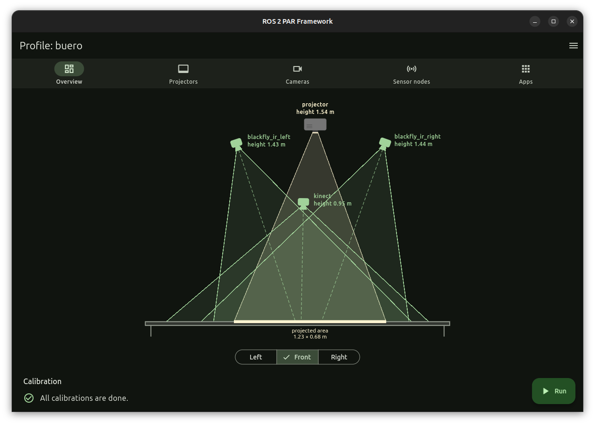

# ROS2 Projected Augmented Reality Framework

> Readme written together with Claude Code. Comments in the Code indicate where Claude Code was used while creating this framework. 

## 1. Overview

A Framework for people who want to build their own Projected Augmented Reality (PAR) setups. 

It is built on the Robot Operating System 2 (ROS2). Most components are fully interchangeable ROS 2 packages that make it modular.

This repository contains the frameworks' core components. 
Depending on your hardware and use case, additional components are required (see list below).

## 2. Hardware

### 2.1 Minimum Hardware requirements
- A Projector
- A camera (Webcam is fine to get started)

Certain applications might require special camera types (e.g. Depth, IR, Thermal, ...) or multiple projectors (currently not yet supported).

### 2.2 Hardware setup

Camera and projector pointed at the same surface. Optimal: Camera sees the entire projected image.


## 3. Installation 

Currently, only manual installation is supported.
While most parts of the framework should run under Windows or MacOS, some parts currently do not. Support for Docker is work in progress and should close this gap.
Everything is currently tested on **Ubuntu 26.04**.

### Prerequisites

Install **ROS2**. Tested with `lyrical`:

Clone this repo and navigate into the folder:
```bash
git clone https://github.com/vigitia/ros2-par-framework.git
cd ros2-par-framework
```

### Framework Installation with the provided Wizard



```bash
./scripts/start_setup_wizard.sh
```

The installation also adds the wizard to the application menu (a .desktop file in ~/.local/share/applications).

The wizard will guide you then through all installation, setup and calibration steps and allows you to test components and

#### Manual installation

```bash
./scripts/local_build.sh
```
`local_build.sh` is safe to re-run — that is also how you pull node updates. 

Missing build tools (rosdep, colcon, Python's venv) are installed on the way; 
for some dependencies it might ask for your sudo password. With `--non-interactive` it never asks: it prints the one `sudo ...` command instead for you to run yourself. 

Dependencies: It installs only what every setup needs (as defined in `config/required_repos.list`). 
Cameras, Sensor Processing Nodes and Apps are chosen per installation: add their lines from `config/catalog_repos.list` to `config/installed_repos.list` (released camera drivers: their rosdep key to `config/installed_ros_packages.list`) and re-run it. 

Source ROS, the python venv and the local ROS2 setup. Then enable Fast DDS Large Data Mode, so that large video streams don't drop packages:
```bash
source /opt/ros/lyrical/setup.bash && source .venv/bin/activate && source install/setup.bash
export FASTDDS_BUILTIN_TRANSPORTS=LARGE_DATA
```

Run the calibration process (with several cameras, once per camera, choosing it with `camera:=<name>`):
```bash
ros2 launch projection_calibration projection_corners.launch.py
```
The calibration launch files come with `ros2-par-framework-calibration`; its README lists all of them.

Launch the framework (the wizard will help you setup custom profiles. Without it, you need to update launch entries manually):
```bash
ros2 launch par_framework_core par.launch.py
```

### Profiles

The wizard allows creation of individual profiles (physical, e.g., a different hardware setup, or digital, e.g., different apps that should launch).


### Repo structure

| Path | Contents |
|---|---|
| `config/required_repos.list` | ROS2 node repositories every installation needs |
| `config/catalog_repos.list` | ROS2 node repositories an installation can add: cameras, sensor nodes, apps (you can also add your own dependencies manually. All are just ROS 2 packages) |
| `config/installed_repos.list` | (gitignored) Repositories that this installation added |
| `config/installed_ros_packages.list` | (gitignored) Released packages this installation added (e.g. camera drivers) |
| `packages/` | This repo's own ROS packages, built together with `src/` |
| `packages/par-framework-core/` | Launch files and parameters (package `par_framework_core`) |
| `packages/par-framework-core/launch/` | ROS2 launch files |
| `packages/par-framework-core/par_framework_core/` | Shared Python modules: `launch_helpers.py` (launch arguments and actions), setup files, camera types, apps, sensor nodes |
| `packages/par_camera_adapters/` | Camera types for third-party drivers (webcam, RealSense, Kinect, Blackfly, event camera) |
| `packages/par_geometry/` | Helper functions for transformations: camera pixels → table (m) → projector pixels |
| `packages/rviz_bridge/` | A ROS2 node that converts framework specific messages (e.g. `/objects`, `/fiduicals`, `/hand_landmarks`) into something RViz can display|
| `scripts/` | Setup and helper scripts |
| `setup_wizard/` | Setup wizard: Flutter app and FastAPI backend helps with setup, profile creation, calibration, as well as debugging and starting of apps |
| `src/` | Installed ROS 2 Node repositories |
| `utils/` | Helper code, e.g. for creating a calibration chessboard pattern |

## Nodes written for the ROS 2 PAR-Framework

The goal of this project is to provide reusable ROS 2 nodes for tasks essential to PAR-Applications: Projector-Camera-Calibration, processing of sensor data (object, hands, gesture, ... detection).
Those custom nodes can be used alongside existing nodes of the ROS 2 catalogue (for now mainly camera drivers, but not limited to them).

Alongside them, multiple PAR-Apps are currently under development that use are built with the framework.

TODO: Add list

---

## Design decisions and conventions

**`FASTDDS_BUILTIN_TRANSPORTS=LARGE_DATA`.** Cameras are an essential part of PAR-setups. A raw 1080p frame is ~6 MB. With ROS 2's Fast DDS's default transports
most frames are lost on the way. This setting fixes it. It must be identical for
**every** ROS 2 process: if only the publisher or only the subscriber has it, they don't connect at all and
nothing arrives (measured between two nodes).

**Per-setup values are parameters, not constants.** Which `/dev/video*` the camera is and which display the
projector is on differ per machine and sometimes even after a restart, so they are ROS parameters: each node declares
its defaults in its code, a camera type for a third-party driver brings its driver defaults as `parameters_file`, and
a profile overrides them; the launch files pass the parameter files to the nodes.

Camera frames are published **best-effort, keep-last-1** — a late frame is worthless because a newer one
already exists. Any subscriber must explicitly request `BEST_EFFORT` too; a subscriber left on the default
reliable profile is QoS-incompatible and silently receives nothing.

### Custom messages, services and actions

They all live in one package, `par_framework_interfaces`, in its own repository.

Nodes declare `<depend>par_framework_interfaces</depend>` and import `from par_framework_interfaces.msg import Object`.
When adding a definition, register it in `rosidl_generate_interfaces()` in `CMakeLists.txt`, and declare any
newly referenced external package (`std_msgs`, `geometry_msgs`, …) in **both** the CMake `DEPENDENCIES` list
**and** `package.xml` — `rosdep` installs dependencies from `package.xml` only.

### Coordinate systems

Four coordinate systems, and every value in the framework is in exactly one of them:

| System | Unit | Origin and axes | Used for |
| --- | --- | --- | --- |
| Camera pixels | px | raw, distorted `image_raw` of the camera: origin top left, x right, y down | everything detectors find (object, contours, fiducials, hand landmarks, gestures, etc.) |
| Camera optical frame (for depth cameras) | m | the image's `header.frame_id`; x right, y down, z forward | what a depth camera measures. This data can be added to pixel coordinate outputs by the detectors. |
| Tabletop/interactive surface, frame `world` | m | z = 0 is the tabletop, z points up | each camera's `projection_mapping`, the RViz output, etc. |
| Projector pixels | px | origin top left of the projected image, at the projector's resolution | what an app draws on the surface |

**`world` is the primary projection surface.** For PAR tabletops this means the tabletop is the plane z = 0 of `world`, in metres, with z pointing away from the
table. Every node that needs table coordinates uses the frame name `world`. The TF tree is `world` → the camera's body frame (the mount transform) → its optical frame (published by
the driver). The camera pose calibration measures height and tilt; x, y and the rotation about the vertical come
from the placeholder in `par_setup.yaml`, so the origin is the point on the table below the camera. Until the poses
of several cameras are measured in one common `world`, each camera's placeholder makes its own table plane, so every
camera has its own projection mapping.

**Messages stay in the frame they were measured in.** Detectors publish camera pixels and optical-frame points,
with the image's `stamp` and `frame_id` copied into their header, and leave conversion to the consumer. A node that
also offers table coordinates adds them next to the pixels instead of replacing them.

**Conversions happen locally, with help from the core package  `par_geometry`.** Nodes call it on their own data:

- camera pixels → table: `pixels_to_table`, which undistorts with the camera's `camera_info` and intersects each pixel's
  ray with z = 0, using the camera pose from TF;
- optical frame → table: `depth_to_table` for a whole depth image, or the pose from TF directly;
- table ↔ projector pixels: `table_to_projector` and `projector_to_table`, with the homography from the camera's
  latched `projection_mapping`;
- above the table → table: `project_to_table` moves a point along its projector ray onto z = 0, so
  `table_to_projector` then gives the pixel that lights it.

**The table plane links camera and projector.** The homography is fitted from markers that `pixels_to_table`
placed on the same plane, so projection accuracy does not depend on an exact camera pose.

---

## Development instructions:

### Adding a node

1. Create the repository containing your new ROS2 node (if you use Python: an `ament_python` package with a `package.xml`, and a `requirements.txt` at its
   root for PyPI dependencies). The package may sit at the repo root or in a subdirectory.
2. Add the new repository to `config/catalog_repos.list` (or to `config/required_repos.list` if every installation needs it), and to your `config/installed_repos.list`.
3. Re-run `./scripts/local_build.sh`, this will clone the repo to `src/`.

### Adding a camera

No change in core and none in the consumers. A camera type is an entry in the ament index plus a launch file that
starts the driver in the camera's namespace and maps its names onto the table above; blueprint and rules:
`templates/par_camera/README.md`. Own drivers already ship them in their repo; for
third-party drivers, add a new entry to `packages/par_camera_adapters/`.
Then:

1. The driver defaults the framework needs (e.g. colour images in BGR order) in a parameter file under
   `/cameras/*/<driver node>`, named as `parameters_file` in the camera entry (e.g.
   `packages/par_camera_adapters/config/realsense.yaml`).
2. A released driver is named in the camera entry's `required_packages` (installations add its rosdep key to
   `config/installed_ros_packages.list`), a driver from source goes into `config/catalog_repos.list`.

