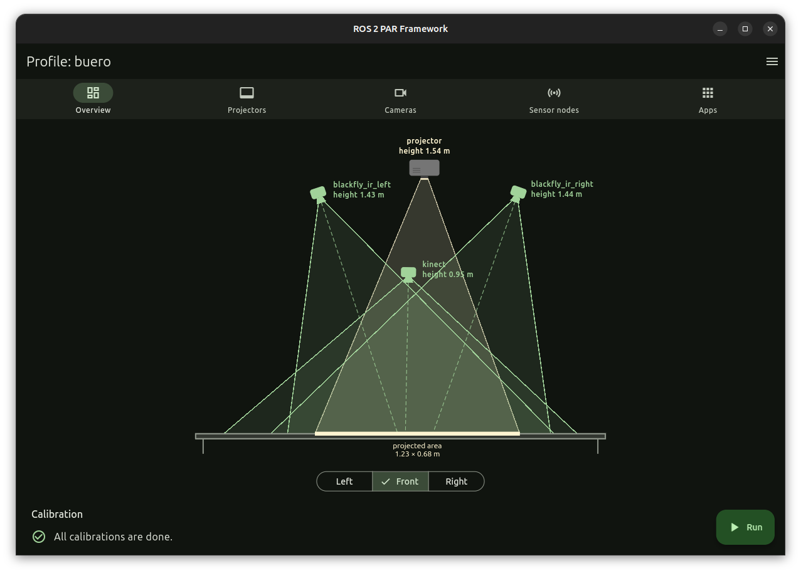

<!-- Partly written by Claude Code -->

# ROS2 PAR-Framework - Setup wizard



Creates, edits and calibrates profiles and launches PAR apps. Two parts:

- `app/`: Flutter desktop app, the user interface.
- `backend/`: FastAPI backend that does everything touching the PAR machine (profiles, cameras, displays,
  launches). The app talks to it at `http://127.0.0.1:8800`, so the backend must run before the app is useful.

## Requirements

- The workspace built with `./scripts/local_build.sh`. It also installs the backend's Python packages
  (`backend/requirements.txt`) into `.venv`.
- Flutter with the Linux toolchain (clang, cmake, ninja, GTK 3 headers). `flutter doctor` shows whether
  "Linux toolchain" is ready and names what is missing.

## Build the app

```bash
cd setup_wizard/app
flutter build linux --release
```

The result is the folder `setup_wizard/app/build/linux/x64/release/bundle/`: the program `par_setup_wizard` with
`lib/` and `data/` next to it. Move or copy the whole folder, never the program alone; it loads its libraries and
assets from there.

## Run

1. Start the backend, in bash from the repository root (ROS's setup scripts only source in bash):

   ```bash
   source /opt/ros/lyrical/setup.bash && source install/setup.bash
   .venv/bin/python setup_wizard/backend/setup_wizard_backend.py
   ```

   API docs, to try every endpoint in the browser: `http://127.0.0.1:8800/docs`

2. Start the app:

   ```bash
   setup_wizard/app/build/linux/x64/release/bundle/par_setup_wizard
   ```

## Develop

`flutter run -d linux` in `setup_wizard/app` builds a debug version and starts it, with hot reload (`r` in the
terminal) and hot restart (`R`). The backend has to run as in step 1.
